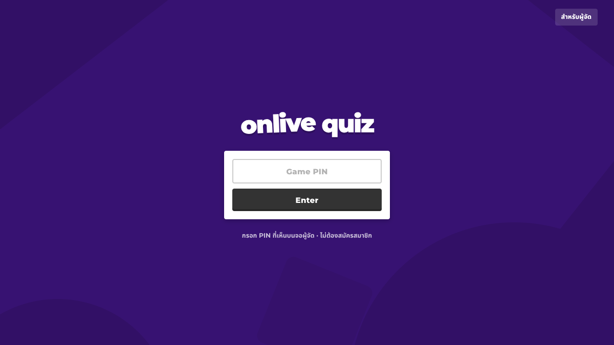
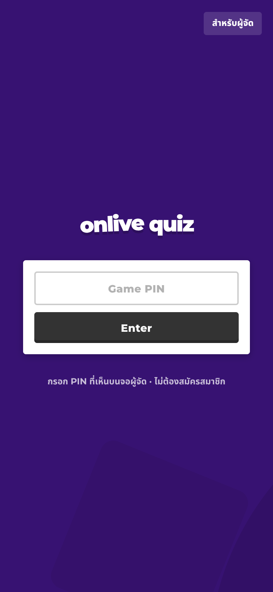
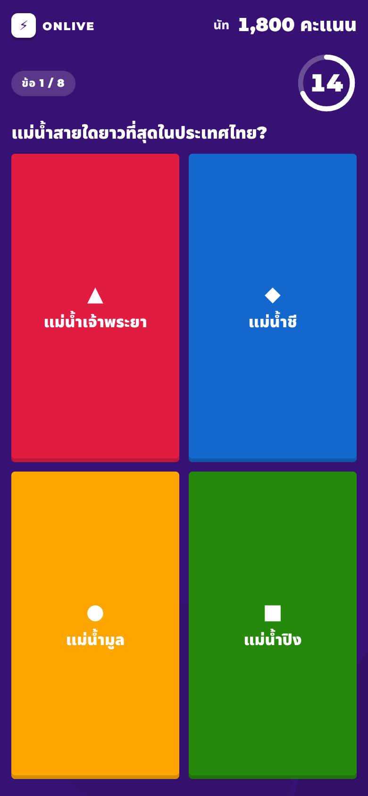
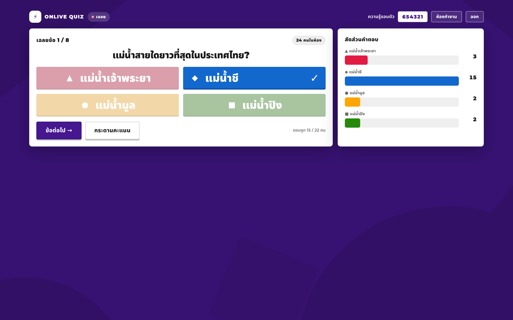
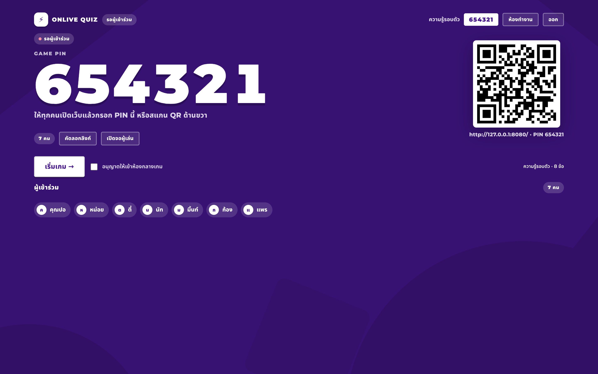
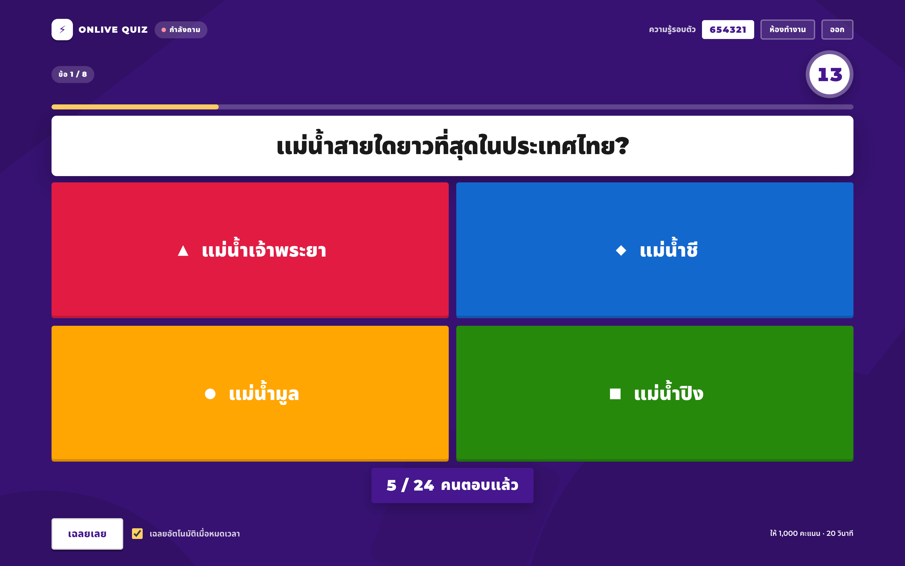

# ⚡ ONLIVE QUIZ — เกมตอบคำถามสดสำหรับงานอบรม

เว็บเกมตอบคำถามสด สำหรับใช้ในห้องอบรม **รองรับผู้เล่นพร้อมกัน 80–100 คน**
ผู้จัดสร้างห้อง → ผู้เข้าอบรมสแกน QR หรือกรอก PIN แล้วแข่งกันตอบคำถาม → คะแนนขึ้นกระดานอันดับแบบเรียลไทม์

- 🌐 หน้าเว็บโฮสต์บน **Vercel** (ฟรี, HTTPS, deploy อัตโนมัติทุก push)
- 🧩 ไฟล์นิ่งล้วน ไม่ต้อง build — ชี้ `outputDirectory` ไปที่ `docs/`
- 🗄️ ข้อมูลและเรียลไทม์ใช้ **Supabase** (Postgres + Realtime)
- 📥 นำเข้าคำถามได้จาก **Excel (.xlsx/.xls) / CSV / JSON** + มี **เทมเพลทให้ดาวน์โหลด**
- 🎵 **เสียงเอฟเฟค + เพลงพื้นหลัง** เปิด–ปิดแยกกันได้ (เพลง / เอฟเฟค) + **เสียงนาฬิกา 5 นาทีสุดท้าย** และเสียงหมดเวลา
- 🎭 **ตัวละครผู้เล่น** — เลือกสัตว์น่ารัก/คน/หุ่นยนต์ ปรับสีผิว เครื่องแต่งกาย และสีเสื้อได้ระหว่างรอเกม
- ✨ **เอฟเฟคชื่อผู้เล่นเด้งเข้าจอผู้จัด** เมื่อมีคนเข้าห้อง (แบบเกมตอบคำถามสด)
- 🏆 **แอนิเมชันบัลลังก์ผู้ชนะ** — ตัวละครค่อย ๆ ปรากฏบนบัลลังก์ มงกุฎ คอนเฟตติ (แบบเกมตอบคำถามสด)
- 🔒 เฉลยและคะแนนคำนวณที่ฐานข้อมูล ผู้เล่นแก้คะแนนหรือดักดูเฉลยไม่ได้
- 🎨 ดีไซน์แนวเกมตอบคำถามสด — พื้น **ม่วงของสำนักงาน ป.ป.ช. `#61116C`** + ทอง `#F8D800` + เขียว `#007838`

---

## ✅ สถานะการติดตั้ง (โปรเจกต์นี้พร้อมใช้แล้ว)

| ส่วน | ที่อยู่ | สถานะ |
|---|---|---|
| เว็บ (Vercel) | **https://naccquiz.vercel.app/** | ✅ Production พร้อมใช้ |
| ห้องทำงานผู้จัด | https://naccquiz.vercel.app/admin | ✅ |
| ฐานข้อมูล (Supabase) | โปรเจกต์ `online-quiz-live` · ref `jxnaazamdiyxpfxqnmgv` · region `ap-southeast-1` | ✅ สคีมา + RLS + ฟังก์ชันครบ |
| Deploy อัตโนมัติ | push เข้า repo นี้ → Vercel สร้าง deployment ใหม่ให้ทันที | ✅ |

ตรวจสุขภาพระบบได้ทุกเมื่อ

```bash
python3 tools/check-assets.py                     # ไฟล์/ลิงก์ใน docs/ ครบไหม
curl -s https://naccquiz.vercel.app/ | head -c 200
```

---

## หน้าตา

| เข้าร่วม (เดสก์ท็อป) | เข้าร่วม (มือถือ) |
|---|---|
|  |  |

| เล่นเกม (มือถือ) | จอผู้จัด — เฉลย |
|---|---|
|  |  |

| จอผู้จัด — ห้องรอ | จอผู้จัด — คำถาม |
|---|---|
|  |  |

> ค่าสี/ขนาด/ระยะทั้งหมดวัดจากเว็บอ้างอิงจริง (สแกนพิกเซล + วัดกล่อง) และบันทึกหลักฐานไว้ที่
> [`docs/design/visual-reference.md`](docs/design/visual-reference.md)
> **ยกเว้นสีม่วง** ที่เปลี่ยนมาใช้สีม่วงของสำนักงาน ป.ป.ช. `#61116C` (สุ่มจากตราสัญลักษณ์ ป.ป.ช.)
> พร้อมสีทอง `#FFDC01` และเขียว `#007E3D` เป็นสีเน้น

---

## เริ่มใช้งานเร็ว ๆ

| ใคร | ลิงก์ | ทำอะไร |
|---|---|---|
| ผู้เข้าอบรม | `https://naccquiz.vercel.app/` | กรอก PIN หรือสแกน QR |
| ผู้จัด / แอดมิน | `…/admin` | สร้างชุดคำถาม นำเข้าไฟล์ เปิดห้อง |
| จอคุมเกม | `…/host?room=<id>` | แชร์ PIN/QR กดเริ่ม–เฉลย–กระดานคะแนน |

ขั้นตอนใช้งานจริงหน้างาน

1. ผู้จัดเข้าสู่ระบบที่หน้าแรก → เข้าห้องทำงาน
2. สร้างชุดคำถามใหม่ (หรือกด **นำเข้าคำถาม** แล้ววาง CSV/JSON)
3. กด **เล่นเลย** → ระบบสร้างห้องและ PIN 6 หลัก พร้อม QR บนจอ
4. ให้ผู้เข้าอบรมสแกน QR (หรือเปิดเว็บแล้วกรอก PIN) แล้วใส่ชื่อ → **🎨 ตกแต่งตัวละคร** ได้ทันที
   (ระหว่างนี้จอผู้จัดจะเล่นเอฟเฟค “ชื่อเด้งเข้ามา” ทุกครั้งที่มีคนเข้าห้อง)
5. เลือก **การแสดงตัวเลือกบนจอ** = ข้อความ+สี หรือ สัญลักษณ์สีเท่านั้น (สลับได้แม้ระหว่างเล่น)
6. กด **เริ่มเกม →** แล้วกด `space` / `ลูกศรขวา` เพื่อไปข้อถัดไป
7. จบเกม → บัลลังก์ผู้ชนะ + สรุปอันดับอัตโนมัติ

ในหน้า **ชุดคำถามของฉัน** มีปุ่มแก้ไขและลบในแต่ละชุด: แก้ไขได้ขณะห้องยังรอผู้เล่นหรือหลังจบเกม แต่จะล็อกระหว่างกำลังเล่นเพื่อไม่ให้คำถาม/คำตอบของห้องเปลี่ยนกลางเกม ส่วนการลบจะแจ้งก่อนยืนยัน เพราะจะลบห้อง ผู้เล่น คะแนน และประวัติที่เชื่อมกับชุดนั้นด้วย

เหนือรายการชุดคำถามมีแผง **ห้องที่เปิดอยู่** ซึ่งจัดการห้องได้ทันที: เข้าห้อง · ปิดห้อง · ลบห้อง (พร้อมผู้เล่น/คะแนน/คำตอบ) และแก้ไขการตั้งค่าห้อง เช่น เปิด–ปิดการเข้าห้องกลางเกม หรือโหมดแสดงตัวเลือกบนจอ

> โปรเจกต์ Supabase เดิมที่มี migration `0001`–`0007` แล้ว ให้รัน `supabase/migrations/0008_restrict_room_reads.sql` ใน SQL Editor เพื่อจำกัดการอ่าน PIN/ข้อมูลห้องให้เห็นได้เฉพาะผู้จัดเจ้าของห้อง
>
> โปรเจกต์ที่มีถึง `0008` แล้ว ให้รัน `supabase/migrations/0009_manage_rooms.sql` เพิ่ม เพื่อเปิดใช้การปิด/ลบห้องจากหน้าห้องทำงาน (ถ้ายังไม่รัน ระบบจะถอยไปอัปเดต/ลบตารางตรง ๆ ตามสิทธิ์ RLS ของเจ้าของห้องให้ก่อน)
>
> หลังจากนั้นให้รัน `supabase/migrations/0010_question_background_capacity_and_owner_purge.sql` เพื่อเพิ่มธีมพื้นหลังคำถาม, จำกัดจำนวนผู้เล่นต่อชุด/ห้อง และเปิดการล้างข้อมูลของบัญชีผู้ใช้ (ต้องยืนยันรหัสผ่านในหน้าเว็บก่อนเรียก RPC)

### อัปโหลด Excel แล้วขึ้น `Could not find the 'max_players' column of 'quizzes' in the schema cache`

ความหมาย: **ฐานข้อมูลยังไม่ได้รัน migration `0010`** (หรือรันแล้วแต่ PostgREST ยังไม่รีเฟรชสคีมา) ทำให้ตาราง `quizzes`/`rooms` ไม่มีคอลัมน์ `max_players` และ `questions` ไม่มีคอลัมน์ `background` — หน้านำเข้า Excel จะสร้างชุดคำถามด้วย `max_players` ทุกครั้ง จึงถูกปฏิเสธทั้งก้อน

วิธีแก้ (เลือกอย่างใดอย่างหนึ่ง)

1. เปิด SQL Editor ของโปรเจกต์ Supabase → วางทั้งไฟล์ `supabase/migrations/0010_question_background_capacity_and_owner_purge.sql` → Run (รันซ้ำได้ ไม่ลบข้อมูลเดิม)
2. หรือสั่งรีเฟรชสคีมาหลังรัน: `notify pgrst, 'reload schema';`
3. ตรวจว่าครบแล้ว: `select table_name, column_name from information_schema.columns where table_schema='public' and column_name in ('max_players','background');` ต้องได้ 3 แถว (`quizzes.max_players`, `rooms.max_players`, `questions.background`)

ตัวเว็บมีตัวกันสำรองแล้ว: ถ้าคอลัมน์ยังไม่มี ระบบจะบันทึกชุดคำถามให้ก่อนโดยตัดเฉพาะคอลัมน์ที่ขาดออก (ฟีเจอร์นั้นใช้ค่าเริ่มต้น) แล้วขึ้นคำเตือนให้รัน migration — การนำเข้า Excel จึงไม่ล้มทั้งก้อนอีก

---

## ทำไมต้องมี Supabase (ทั้งที่เว็บเป็นไฟล์นิ่ง)

เว็บ (Vercel) เป็นที่โฮสต์ **ไฟล์นิ่ง** เท่านั้น — ไม่มีเซิร์ฟเวอร์หลังบ้าน ไม่มี WebSocket
จึงเก็บคะแนนหรือดันคำถามไปพร้อมกัน 100 เครื่องไม่ได้ด้วยตัวเอง
สถาปัตยกรรมนี้จึงแยกเป็น

```
เบราว์เซอร์ 100 เครื่อง
        │  (HTTPS + Realtime WebSocket)
        ▼
   Supabase  ←→  Postgres (เก็บคำถาม/ห้อง/ผู้เล่น/คำตอบ) + RLS + RPC
        ▲
        │  ไฟล์ HTML/CSS/JS นิ่ง
      Vercel
```

- **ทุกการเขียนข้อมูล** ผ่านฟังก์ชัน `RPC` ที่ฝั่งฐานข้อมูล (security definer)
- **RLS (Row Level Security)** เปิดทุกตาราง: `anon` (ผู้เล่น) มองไม่เห็นตารางคำถาม/ผู้เล่น/คำตอบเลย
- **เวลาของแต่ละข้อกำหนดที่เซิร์ฟเวอร์** (`question_ends_at`) มือถือตั้งเวลาโกงไม่ได้
- การซิงก์หน้าจอใช้ **Realtime broadcast** (ข้อความ `sync` สั้น ๆ) + **polling สำรองทุก 5 วินาที**
  ถ้าสัญญาณหลุด 1–2 ครั้ง เกมไม่สะดุด

---

## โครงสร้างไฟล์

```
docs/                     ← โฟลเดอร์ที่ Vercel เสิร์ฟ (outputDirectory)
  index.html              หน้าแรก: ผู้เล่นกรอก PIN / ผู้จัดเข้าสู่ระบบ
  play.html               หน้าผู้เล่น (ตอบคำถาม เฉลย อันดับ)
  host.html               จอผู้จัด (PIN + QR, คุมเกม, กราฟสัดส่วนคำตอบ)
  admin.html              ห้องทำงาน (สร้าง/แก้ไข/นำเข้าชุดคำถาม)
  assets/css/app.css      ธีมทั้งหมด
  assets/js/config.js     ★ ใส่ URL + anon key ของ Supabase ที่นี่
  assets/js/api.js        ชั้นเชื่อมต่อ Supabase (RPC/auth/realtime)
  assets/js/sound.js      ★ ระบบเสียง: เพลง 3 แพ็ก/เอฟเฟค/นาฬิกา 5 นาที + ปุ่มเปิด–ปิด (Web Audio)
  assets/js/avatars.js    ★ ตัวละครผู้เล่น (สัตว์/คน/หุ่นยนต์ + สีผิว + เครื่องแต่งกาย) + ตัวเลือกแต่งตัว
  assets/js/fx.js         ★ เอฟเฟค: ชื่อผู้เล่นเด้งเข้าจอผู้จัด, ประกาย, คอนเฟตติ
  assets/js/podium.js     ★ บัลลังก์ผู้ชนะ + ตัวละคร SVG + คอนเฟตติ
  assets/js/page-*.js     ลอจิกแต่ละหน้า
  assets/js/vendor/       supabase-js, qrcode-generator, SheetJS (ฝังมา ไม่ต้องพึ่ง CDN)
  samples/sample-quiz.csv      ตัวอย่าง CSV
  samples/quiz-template.xlsx   ★ เทมเพลท Excel (2 ชีต: คำถาม / คำแนะนำ)
vercel.json               ★ ตั้งค่า Vercel: เสิร์ฟ docs/ แบบ static + cache/security headers
tools/make-quiz-template.mjs  สร้าง samples/quiz-template.xlsx ใหม่
tools/ui-smoke-test.mjs       ทดสอบ DOM (ปุ่มเสียง/บัลลังก์/ตัวนำเข้า) ด้วย jsdom
tools/e2e/run-pages.mjs       ★ ทดสอบหน้าเว็บจริงทั้ง 4 หน้า (169 ข้อ) ด้วย jsdom + API ปลอม
docs/reports/e2e-10-rounds.md ★ รายงานผลทดสอบ 10 รอบ + ทดสอบโหลด 100 ผู้เล่น
tools/check-assets.py         ตรวจไฟล์/ลิงก์ภายในก่อน deploy
supabase/migrations/0001_init.sql   สคีมา + RLS + ฟังก์ชันทั้งหมด (รันใน SQL Editor)
supabase/migrations/0002_avatar_show_options.sql   ★ ตัวละครผู้เล่น + โหมดแสดงตัวเลือก + คิวผู้เล่นเข้าห้อง
supabase/migrations/0003_fix_answer_choice_range.sql   กันการส่งตัวเลือกนอกช่วง
supabase/migrations/0004_room_state_machine.sql       ★ บังคับลำดับสถานะห้อง (จบแล้วย้อนกลับไม่ได้)
supabase/migrations/0005_rejoin_in_lobby.sql          ★ เข้าห้องซ้ำด้วยชื่อเดิมได้ (คืนที่นั่งเดิม)
supabase/migrations/0006_question_integrity.sql      ตรวจความถูกต้องของคำถามและตัวเลือก
supabase/migrations/0007_restart_room.sql            ★ เริ่มรอบใหม่ในห้องเดิม
supabase/migrations/0008_restrict_room_reads.sql      ★ ซ่อน PIN/ข้อมูลห้องจากผู้ใช้ที่ไม่ใช่เจ้าของ
supabase/migrations/0009_manage_rooms.sql            ★ ปิด/ลบห้องจากหน้าห้องทำงาน (เจ้าของห้องเท่านั้น)
supabase/migrations/0010_question_background_capacity_and_owner_purge.sql  ★ ธีมคำถาม/จำกัดผู้เล่น/ล้างข้อมูลเจ้าของ
supabase/seed_demo.sql              (ไม่บังคับ) ชุดคำถามตัวอย่าง 8 ข้อ
```

---

## นำเข้าคำถาม

หน้าห้องทำงาน → **นำเข้าคำถาม** มีทั้งลากไฟล์มาวาง (drag & drop) และเลือกไฟล์จากเครื่อง

| นามสกุล | อ่านอย่างไร |
|---|---|
| `.xlsx` `.xls` `.xlsm` | เปิดด้วย SheetJS → อ่าน **ชีตแรกที่มีข้อมูล** (เว้นว่าง/แถวว่างถูกข้าม) |
| `.csv` `.tsv` `.txt` | ตรวจตัวคั่น (จุลภาค/แท็บ) ให้อัตโนมัติ |
| `.json` | อ่านเป็น array ของคำถาม |

### เทมเพลท
- ปุ่ม **⬇ เทมเพลท Excel (.xlsx)** สร้างไฟล์ให้ทันที (ชีต “คำถาม” + ชีต “คำแนะนำ”)
- หรือโหลดไฟล์สำเร็จรูป: [`docs/samples/quiz-template.xlsx`](docs/samples/quiz-template.xlsx) / [`sample-quiz.csv`](docs/samples/sample-quiz.csv)
- สร้างเทมเพลทใหม่จากโค้ด: `node tools/make-quiz-template.mjs`

### คอลัมน์ที่รองรับ

| คอลัมน์ | ความหมาย |
|---|---|
| `question` | โจทย์ |
| `option1` … `option6` | ตัวเลือก 2–6 ข้อ |
| `correct` | เลขข้อที่ถูก (`1`–`6`) หรือ `A`–`F` หรือข้อความตัวเลือกนั้น |
| `time_limit` | วินาที (5–300) ค่าเริ่มต้น 20 |
| `points` | คะแนนเต็ม (100–4000) ค่าเริ่มต้น 1000 |
| `image_url` | รูปประกอบ (ไม่บังคับ) |
| `show_options` | การแสดงตัวเลือกของข้อนั้น: `text` / `shape` (เว้นว่าง = ตามที่ผู้จัดตั้ง) |

หัวตารางภาษาไทยก็ใช้ได้: `คำถาม`, `ตัวเลือก1…6`, `เฉลย`, `เวลา`, `คะแนน`, `รูป`
(ตัวคั่น/เครื่องหมายคำพูดในเซลล์/ภาษาไทย จัดการให้อัตโนมัติ)

### JSON
```json
[
  { "prompt": "เมืองหลวงของไทย?", "options": ["เชียงใหม่","กรุงเทพ","ภูเก็ต"],
    "correct_index": 1, "time_limit": 20, "points": 1000 }
]
```

---

## 🔊 เสียงและเพลง (เปิด–ปิดได้)

ทุกระบบเสียง **สังเคราะห์สดด้วย Web Audio** — ไม่มีไฟล์ mp3 ให้โหลด เว็บจึงเร็วและใช้ได้แม้ออฟไลน์

| เสียง | ดังเมื่อ |
|---|---|
| เพลงพื้นหลัง 3 แพ็ก | `ชิล` (ห้องรอ) · `ตื่นเต้น` (ตอนตอบ) · `ไพเราะ` (เบา ๆ) — เลือกได้ในแผงเสียง |
| นาฬิกา tick-tock | ช่วง **N วินาทีสุดท้าย** ของแต่ละข้อ (ค่าเริ่มต้น **300 วินาที = 5 นาทีสุดท้าย** ตามที่ขอ · ปรับได้ 5 วิ – 5 นาที) |
| เตือนใกล้หมดเวลา | เมื่อเข้าสู่นาฬิกาเตือนครั้งแรก |
| ใจเต้น (heartbeat) | ทุก 30 วินาที ในช่วงเตือนยาว ๆ + เพลงเร่งจังหวะ |
| หมดเวลา | เมื่อเวลาข้อนั้นหมด (`timeup`) |
| เอฟเฟค | เข้าห้อง (`join`+`announce`), เริ่มข้อแบบตื่นเต้น (`suspense`), กดตอบ, เฉลย (`drumroll`→`reveal`), ถูก/ผิด, สตรีค, เปลี่ยนจอ (`whoosh`), แชมป์ (`podium`+`cheer`) |

**เปิด–ปิดแยกส่วนได้:** กดปุ่มลำโพงมุมขวาล่างทุกหน้า →

- `เปิดเสียงทั้งหมด`
- `เพลงพื้นหลัง` (เปิด/ปิดเฉพาะเพลง)
- `เอฟเฟคเสียง` (เปิด/ปิดเฉพาะเอฟเฟค)
- แพ็กเพลง · ช่วงนาฬิกาเตือน · ความดัง

จอผู้จัดยังมี **ปุ่มลัด 2 ปุ่ม** (🎵 เพลง / 🔊 เอฟเฟค) ที่ห้องรอ กดสลับได้ทันทีหน้างาน
ค่าที่เลือกถูกจำไว้ในเครื่อง (localStorage) และแก้ค่าเริ่มต้นได้ที่ `config.js` → `SOUND`

> เบราว์เซอร์ไม่อนุญาตให้เล่นเสียงก่อนผู้ใช้แตะหน้าจอ — เพลงจะเริ่มที่การคลิก/กดแป้นครั้งแรก

---

## 🎭 ตัวละครผู้เล่น (Avatar) + ตกแต่งระหว่างรอ

ผู้เล่นทุกคนมี **ตัวละครของตัวเอง** ใช้แสดงบนจอผู้จัด กระดานคะแนน และบัลลังก์ผู้ชนะ

- **ตัวละคร 14 แบบ** — น้องหนู/น้องฟ้า/น้องภูมิ/คุณครู/นักสืบ, แมวส้ม หมาน้อย กระต่าย แพนด้า
  จิ้งจอก หมีอุ่น กบเขียว นกฮูก และหุ่นยนต์
- **สีผิว 6 เฉด** (มนุษย์ปรับสีผิว ผิวสัตว์จะผสมให้อัตโนมัติ)
- **เครื่องแต่งกาย 12 แบบ** — มงกุฎ หมวกปาร์ตี้ หมวกแก๊ป หมวกรับปริญญา หมวกนักสืบ
  แว่นกันแดด โบว์ ดอกไม้ หูฟัง วงแหวนเทวทูต และ **เข็ม ป.ป.ช.**
- **สีเสื้อ 10 สี** (มีม่วง ป.ป.ช. เป็นค่าแรก)
- กด **🎨 ตกแต่งตัวละคร** ได้ทั้งตอนใส่ชื่อ และ **ระหว่างรอผู้จัดกดเริ่มเกม** — บันทึกอัตโนมัติ
  ลงเครื่อง (localStorage) และส่งขึ้นฐานข้อมูล (`set_avatar`) เพื่อให้จอผู้จัดเห็นทันที
- ไม่เคยเลือก → ระบบสร้างตัวละครให้จากชื่อ (คงที่ทุกครั้งที่เข้าห้อง)

---

## ✨ เอฟเฟคและลูกเล่นบนเวที

| เอฟเฟค | เกิดเมื่อ |
|---|---|
| **ชื่อผู้เล่นเด้งเข้าจอผู้จัด** | มีคนเข้าห้อง (ป้ายขาว+ตัวละคร+ประกายดาว+เสียงประกาศ) แม้อยู่ระหว่างเล่น |
| ชิปผู้เล่นมีตัวละครจริง | ห้องรอ / กระดานคะแนน / สรุปอันดับ (มีรูปตัวละครย่อทุกแถว) |
| เริ่มข้อแบบตื่นเต้น | ไรเซอร์ + กลอง + เพลงตื่นเต้น + ไทล์คำตอบเด้งเข้าทีละใบ |
| เฉลยแบบเกมโชว์ | กลองรัว → เสียงเฉลย → ตัวเลือกที่ผิดหรี่ลง เหลือข้อถูกเด่น |
| ตอนจบ | กลองรัว → **ตัวละครค่อย ๆ โผล่บนบัลลังก์** → มงกุฎลอยลง → ประกายดาว → คอนเฟตติ + เสียงเชียร์ |
| ป้ายผู้ชนะ | ชื่อแชมป์เด้งกลางจอพร้อมถ้วย |

> ทุกอนิเมชันเคารพ `prefers-reduced-motion` — เครื่องที่ตั้งลดการเคลื่อนไหวจะข้ามแอนิเมชันให้

---

## 🖥️ ผู้จัดเลือกได้: แสดงข้อความ หรือแค่สัญลักษณ์สี

ที่หน้าห้องรอ จอผู้จัดมีสวิตช์ **“การแสดงตัวเลือกบนจอ”**

| โหมด | ผู้เล่นเห็น |
|---|---|
| `ข้อความ + สี` (ค่าเริ่มต้น) | ไทล์สีพร้อมข้อความตัวเลือกครบ |
| `สัญลักษณ์สีเท่านั้น` | เห็นแค่ ▲ ◆ ● ■ พร้อมสี — เหมาะกับข้อที่ไม่อยากให้อ่านยาว |

- ตั้งได้ **ต่อห้อง** (สลับได้แม้ระหว่างเล่น มีผลข้อถัดไปทันที) และ **ต่อข้อ** ที่หน้าห้องทำงาน
  (คอลัมน์ `show_options` ใน Excel หรือช่องเลือกในตัวแก้ไขคำถาม — เว้นว่าง = ตามที่ผู้จัดตั้ง)
- **ตอนเฉลยจะแสดงข้อความเต็มเสมอ** เพื่อให้ผู้เข้าอบรมได้เรียนรู้คำตอบ พร้อมโน้ตย้ำว่าเล่นโหมดสัญลักษณ์อยู่

---

## 🏆 จบเกม: บัลลังก์ผู้ชนะ

เมื่อกด **จบเกม** จอผู้จัดจะเล่นแอนิเมชัน

1. บัลลังก์ทองค่อย ๆ ปรากฏ + แสงสปอตไลต์หมุน
2. **ตัวละครของผู้ชนะค่อย ๆ โผล่ขึ้นบนบัลลังก์** (fade + ขยาย + เด้งเบา ๆ)
3. มงกุฎลอยลงสวม + ประกายดาว
4. ผู้เล่นอันดับ 2 และ 3 ขึ้นแท่นเงิน/ทองแดง
5. คอนเฟตติ + เสียงแฟนแฟร์ และสรุปอันดับเต็มด้านล่าง

ตัวละครสร้างจาก **ชื่อผู้เล่น** (สี/ทรง/ของประดับคงที่ต่อคน) เป็น SVG ล้วน —
มือถือผู้เล่นก็เห็นตัวละครของตัวเองบนแท่นเมื่อจบเกม
(ถ้าเครื่องตั้ง `prefers-reduced-motion` ระบบจะข้ามแอนิเมชันให้)

---

## คะแนนคิดอย่างไร

```
ถูกต้อง  → points × (0.55 + 0.45 × สัดส่วนเวลาที่เหลือ)
ตอบผิด   → 0
ตอบถูกติดกันครบ 3 ข้อขึ้นไป → โบนัส +100 ต่อข้อ (สตรีค)
```
ตอบเร็วได้เปรียบ แต่ยังได้คะแนนฐาน 55% แม้ตอบช้า — และคะแนนทั้งหมดคำนวณฝั่งเซิร์ฟเวอร์

---

## รองรับคนเยอะแค่ไหน

ทดสอบบนโปรเจกต์จริงด้วยผู้เล่น 100 คน **ยิง HTTP จริงพร้อมกัน** ผ่าน PostgREST
(รายละเอียดทั้งหมด: [`docs/reports/e2e-10-rounds.md`](reports/e2e-10-rounds.md)):

| รายการ | ผล |
|---|---|
| ผู้เล่น 100 คนเข้าห้องพร้อมกัน | สำเร็จ 100/100 · เฉลี่ย **10 ms**/คำขอ (สูงสุด 17 ms) |
| ตอบคำถามพร้อมกัน 100 คน (ข้อเดียวกัน) | สำเร็จ 100/100 · เฉลี่ย **6 ms**/คำขอ · p95 10 ms |
| คะแนนซ้ำ/แถวซ้ำในฐานข้อมูล | 0 (กันได้ด้วย unique index + `FOR UPDATE`) |
| `host_snapshot` ตอนมี 100 คน | 5 ms |
| งานฐานข้อมูลทั้งเกม (ทรานแซกชันเดียว) | ~0.3 วินาที |

### ขีดจำกัดตามแพ็ก Supabase

| แพ็ก | Realtime connections (ผู้เล่นพร้อมกัน) | ข้อความ Realtime/เดือน |
|---|---|---|
| **Free** | **200 concurrent peak connections** · แอปจำกัดผู้เล่นรวมทุกห้องไว้ **120 คน** | 2,000,000 |
| Pro | 500 concurrent peak connections | 5,000,000 |
| Team | 500 included (ตรวจเพดานตามสัญญา/การใช้งานจริง) | ตามแพ็กเกจ |

อ้างอิง [Supabase Pricing](https://supabase.com/pricing): Free ให้ Realtime สูงสุด 200 concurrent peak connections
และ 2 ล้านข้อความ/เดือน ส่วน Pro ให้ 500 connections และ 5 ล้านข้อความ/เดือน
ผู้เล่นแต่ละหน้าที่เข้าร่วมเกมเปิด Realtime Broadcast channel หนึ่ง connection; 500 คนจึงเกินโควตา Free
แน่นอน แม้ฐานข้อมูลอาจรับ HTTP requests ได้ก็ตาม

เพื่อกันชนเพดานและเหลือ headroom แอปบังคับไม่ให้มีที่นั่งผู้เล่นค้างอยู่ในห้องที่ยังไม่จบรวมเกิน **120 คนต่อโปรเจกต์**
(กันเพิ่มใน SQL และ serialize การเข้าร่วมข้ามห้อง) เหลือ 80 connections ไว้สำหรับ host/client หรือ traffic อื่น
ตัวเลข 120 เป็น safety cap ไม่ใช่การรับประกัน throughput หรือจำนวนที่ทดสอบโหลดแล้ว และการใช้งานอื่นที่ต่อ Realtime
ในโปรเจกต์เดียวกันก็ใช้โควตาเดียวกันด้วย; ค่า 0 ในเพดานรายชุดแปลว่า “ไม่มีเพดานเพิ่มต่อชุด” ไม่ได้ยกเลิกเพดานรวม 120 คน.

> ระดับ subscription ของโปรเจกต์จริงไม่ได้แสดงในข้อมูลโครงการที่เชื่อมต่อมา จึงตั้งค่าปลอดภัยโดยยึด Free ไว้ก่อน

### แล้วอะไรเป็นตัวชี้วัดจริง?

- **คำตอบ:** 100 คน × 1 ข้อ = 100 แถว กระจายใน 15–20 วินาที ≈ **5–7 คำตอบ/วินาที**
  ซึ่งห่างจากขีดจำกัด Postgres/Supabase มาก — ต่อให้ 300 คนก็ยัง ≈ 20 คำตอบ/วินาที
  (ลด polling ของจอผู้จัดเหลือ 2.5 วินาที และสถิติเหลือ 2.5 วินาทีแล้วเพื่อประหยัดโควตา)
- **Egress 5 GB/เดือน (Free):** 1 เกม 100 คน × 20 ข้อ ใช้ราว **30–60 MB**
  → เล่นได้ประมาณ **80–150 เกม/เดือน** ก่อนชนเพดาน (แต่ละเกมใช้ข้อมูลจริงจับต้องได้)
- **ขนาดฐานข้อมูล 500 MB:** เก็บคำตอบได้หลายล้านแถว — ไม่ใช่ข้อจำกัดในทางปฏิบัติ
- **โปรเจกต์ Free จะหยุด (pause) ถ้าไม่มีการใช้งาน 7 วัน** → ปลุกก่อนงานด้วยการเปิดหน้าเว็บ 1 ครั้ง

### สรุปคำแนะนำหน้างาน

| จำนวนผู้เข้าอบรม | แพ็กที่แนะนำ | หมายเหตุ |
|---|---|---|
| ไม่เกิน 100 คน | Free | มี margin จาก hard cap 120 |
| 101–120 คน | Free | ยังอยู่ใต้ hard cap แต่เหลือ headroom น้อยลง |
| มากกว่า 120 คน | Pro แล้วปรับ cap/ทดสอบโหลดก่อน | 500 connections เป็นโควตา ไม่ใช่ throughput guarantee |


---

## Deploy บน Vercel

โปรเจกต์นี้เป็น **ไฟล์นิ่งล้วน** (ไม่มี build) — Vercel จึงเสิร์ฟโฟลเดอร์ `docs/` ตรง ๆ
ตามที่กำหนดใน [`vercel.json`](vercel.json)

```json
{
  "buildCommand": null,
  "outputDirectory": "docs",
  "cleanUrls": true
}
```

| ขั้น | ทำอะไร |
|---|---|
| 1 | push เข้า repo → Vercel ตรวจจับอัตโนมัติ (Git integration) |
| 2 | ติดตั้ง dependency: ไม่มี (static) |
| 3 | build: ไม่มี — ยกโฟลเดอร์ `docs/` ขึ้น CDN |
| 4 | ได้ URL production: `https://naccquiz.vercel.app/` |

- `cleanUrls: true` → เปิด `/admin` และ `/play` ได้โดยไม่ต้องพิมพ์ `.html`
- `trailingSlash: false` → URL ไม่มี `/` ต่อท้าย (ยกเว้น root)
- ไฟล์ใน `docs/assets/**` ถูก cache 1 วัน, ส่วน HTML ตรวจใหม่ทุกครั้ง
- ใส่ security headers ให้แล้ว (`nosniff`, `X-Frame-Options`, `Referrer-Policy`, `Permissions-Policy`)

ตรวจไฟล์/ลิงก์ภายในและทดสอบหน้าเว็บก่อน push ได้ด้วยคำสั่งเดียว

```bash
npm install                  # ครั้งแรกครั้งเดียว (jsdom)
npm test                     # ทดสอบ DOM 49 ข้อ + ทดสอบหน้าเว็บจริง 72 ข้อ
npm run test:e2e             # เฉพาะทดสอบหน้าเว็บจริง 4 หน้า
npm run check                # ตรวจไฟล์/ลิงก์ภายใน
```

> `npm test` ไม่ต้องต่ออินเทอร์เน็ต — ใช้ jsdom + API ปลอมที่ป้อนข้อมูลโครงสร้างเดียวกับที่
> เซิร์ฟเวอร์จริงตอบ จึงรันใน CI หรือเครื่องที่ไม่มีเน็ตได้

> `.github/workflows/deploy-pages.yml` ยังอยู่ใน repo แต่ถูกปรับให้รัน **ด้วยมือเท่านั้น**
> (Actions → *Deploy web (GitHub Pages — ทางเลือกสำรอง)* → Run workflow) เพื่อไม่ให้ชนกับ Vercel

### ตั้งค่า Vercel ครั้งแรก (ถ้าสร้างโปรเจกต์ใหม่)

1. vercel.com → **Add New… → Project** → เลือก repo นี้
2. Framework Preset: **Other** · Root Directory: `.` · Output Directory: `docs`
3. Build & Install Command: เว้นว่าง · Environment Variables: ไม่ต้องใช้
4. Deploy → เอา URL ที่ได้ไปใส่ `site_url` ใน Supabase (Authentication → URL Configuration)

---

## ติดตั้งเอง (ถ้าอยากแยกโปรเจกต์ใหม่)

1. สร้างโปรเจกต์ Supabase ใหม่ (เลือก region `ap-southeast-1` สิงคโปร์ ใกล้ไทยที่สุด)
2. เปิด SQL Editor → รันไฟล์ใน `supabase/migrations/` ตามลำดับเลข ตั้งแต่ `0001_init.sql` ถึง migration ล่าสุด (ทีละไฟล์)
3. Authentication → Providers → Email เปิดไว้ และปิด “Confirm email” (เพื่อให้สมัครแล้วใช้ได้เลย)
4. คัดลอก `Project URL` + `anon public key` ไปใส่ `docs/assets/js/config.js`
5. เลือก **Confirm email = ปิด** และใส่ `Site URL` = โดเมน Vercel ของคุณ
   (Authentication → URL Configuration → Redirect URLs ใส่ `<โดเมน>/**` ด้วย)
6. push repo ขึ้น GitHub → import เข้า Vercel (Framework: Other, Output Directory: `docs`)
7. (ถ้าเปลี่ยนโดเมน) แก้ `PUBLIC_URL` ใน `config.js` หรือปล่อยว่างเพื่อให้ QR ชี้โดเมนที่เปิดอยู่

---

## ความปลอดภัย

- `anon key` ที่ฝังในหน้าเว็บเปิดเผยได้ตามปกติของ Supabase — สิทธิ์จริงถูกคุมด้วย RLS
- ผู้เล่นอ่าน `questions`, `players`, `answers` **ไม่ได้เลย** (RLS คืน 0 แถว) จึงไม่มีทางเห็นเฉลยหรือ token คนอื่น
- ฟังก์ชันฝั่งผู้จัดทุกตัวตรวจ `host_id = auth.uid()` — คนอื่นเรียกแล้วได้ `forbidden`
- การอ่าน `rooms` โดยตรงจำกัดเฉพาะ host เจ้าของห้อง (`0008_restrict_room_reads.sql`); ผู้เล่นอ่านสถานะผ่าน RPC ที่เปิดเผยเฉพาะข้อมูลจำเป็น
- กันการตอบซ้ำด้วย unique index + row lock, กันการตอบหลังหมดเวลาที่เซิร์ฟเวอร์
- ถ้าต้องการปิดรับสมัครบัญชีผู้จัดเอง: Authentication → ปิด “Allow new users to sign up”
- Supabase ของโปรเจกต์นี้ตั้ง `Site URL` และ Redirect URLs เป็นโดเมน Vercel แล้ว
  (`https://naccquiz.vercel.app/**` + preview `https://nacc-quiz-*.vercel.app/**` + localhost)

## ข้อจำกัดที่ตั้งใจให้เรียบง่าย

- ไม่มีการอัปโหลดไฟล์รูป — ใช้ URL รูปแทน (ประหยัดพื้นที่และค่า bandwidth)
- ไม่มีระบบเก็บประวัติคะแนนระยะยาว/ส่งออก CSV (ข้อมูลอยู่ในตาราง `answers` ถ้าต้องการต่อยอด)
- หนึ่งห้อง = หนึ่งชุดคำถาม และทุกคนตอบชุดเดียวกัน (ไม่มีโหมดทีม)
